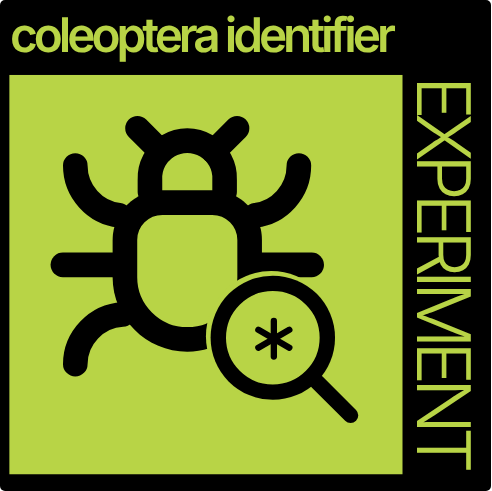
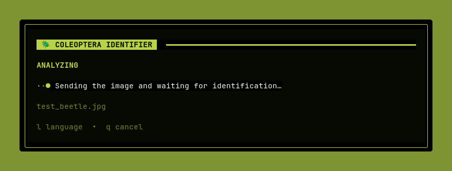
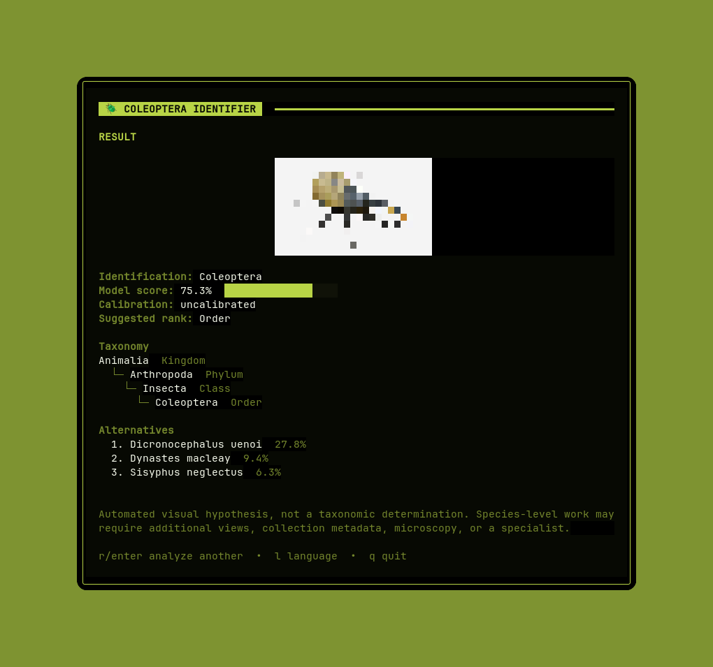
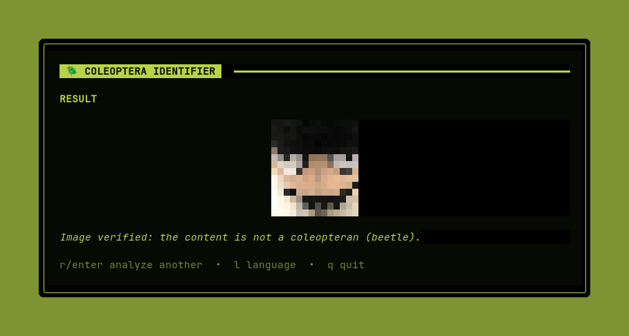

# 🪲 Coleoptera Identifier



A prototype for visual taxonomic identification of beetles. The API runs
[BioCLIP](https://github.com/Imageomics/BioCLIP) on the server and returns the
most specific visual hypothesis allowed by configured heuristic thresholds:
order, family, genus, or species.

This project is free software licensed under the **GNU General Public License
v3.0 (GPL-3.0-only)**. See the complete terms in [`LICENSE.txt`](./LICENSE.txt).

The result is **not a taxonomic determination**. Some species require additional
views, collection metadata, scale, microscopy, or examination by a specialist.

> I'm not a biologist. I'm just a software developer with a lot of curiosity. 
If you think this is a big mistake, you can always contribute by opening an issue 
or submitting a PR.

## Prototype focus

The prototype focuses on **Coleoptera species cataloged in Brazil**. The
[Catálogo Taxonômico da Fauna do Brasil (CTFB)](https://fauna.jbrj.gov.br/fauna/)
is the reference for selecting positive evaluation examples. A species can be
in scope even when a particular photo was taken outside Brazil; the species'
catalog status and the photo's location are recorded separately. Images of
non-Coleoptera are deliberate negative examples for measuring rejection.

This geographic catalog focus is an evaluation and product target, not yet an
enforced API constraint. The current BioCLIP runtime compares an image against
its full represented Tree of Life for the order decision and considers all
represented Coleoptera taxa for lower-rank suggestions. It does not filter
species against the CTFB. A species-level suggestion therefore does not yet
guarantee that the name is cataloged in Brazil. The first scientific evaluation
will measure this behavior before a Brazilian species filter or an out-of-scope
response is added. See the [evaluation image protocol](./data/evaluation/README.md).

The separate [Photo Curator TUI](./curator/README.md) helps collect evaluation
photos from iNaturalist while keeping taxonomic and credit review manual.

## Showcase

<p align="center">
  
</p>

<p align="center">
  
</p>

<p align="center">
  
</p>

## Architecture

```text
Go CLI/TUI
    │ Base64 image
    ▼
FastAPI ── technical image validation
    │
    ▼
BioCLIP ── general classification by order
    │
    ├── outside Coleoptera → suggestion outside the order
    │
    └── Coleoptera → taxonomic candidates + suggested rank
                              │
                              └── GBIF: optional name normalization
```

The model is loaded only on the first identification request. Starting the API
and accessing its health endpoint do not download model artifacts or contact
external services.

### Scope validation

The current preprocessing is limited to technical validation of the submitted
image: supported format, file size, decodability, minimum dimensions, maximum
pixel count, and supported aspect ratio. It does not determine whether the
image contains a beetle, an invertebrate, another animal, or no relevant
organism.

Consequently, an image outside the project's biological scope can still reach
BioCLIP. Since BioCLIP compares the image against its catalog and does not
provide a reliable open-set `unknown` class, its score must not be interpreted
as proof that the image contains a coleopteran.

The recommended future architecture is a separate binary classification head
before BioCLIP:

```text
image
  └── technical validation
        └── binary Coleoptera gate
              ├── rejected or inconclusive → outside project scope
              └── accepted → BioCLIP taxonomic suggestion
```

The head should be trained to distinguish `Coleoptera` from `not-Coleoptera`,
including hard negative examples such as humans, plants, objects, spiders,
other insects, and other animals. A practical implementation can initially
freeze a pretrained visual encoder, train only a binary linear head, and
calibrate its rejection threshold on a representative validation set. This
head is not implemented yet; the current API sends technically valid images
directly to BioCLIP.

## Requirements

- Python 3.10 or newer, using a version supported by the installed PyTorch release.
- `libmagic` installed on the system.
- Enough memory and storage for the BioCLIP artifacts.

<details>
<summary>System dependency on Debian or Ubuntu</summary>

```bash
sudo apt-get install libmagic1
```

</details>

<details>
<summary>System dependency on Fedora and similar distributions</summary>

On Fedora, RHEL, Rocky Linux, and AlmaLinux, the `file-libs` package provides
the `libmagic` library used by `python-magic`:

```bash
sudo dnf install python3 python3-pip file-libs
```

On older systems that still use `yum`, the equivalent command is:

```bash
sudo yum install python3 python3-pip file-libs
```

</details>

<details>
<summary>Other distributions</summary>

Install the runtime package that provides `libmagic` using your distribution's
package manager. The package is commonly named `libmagic`, `libmagic1`, or
`file-libs`.

</details>

## Installation

```bash
python3 -m venv .venv
source .venv/bin/activate
python -m pip install --upgrade pip
python -m pip install -r requirements.txt
```

The original BioCLIP model, based on ViT-B/16, is the default because it is
smaller than BioCLIP 2. To download and initialize its artifacts before starting
the API:

```bash
python -m app.services.preload
```

## Removing local model artifacts

BioCLIP model weights and Tree of Life embeddings are stored in the Hugging Face
cache, separately from the Python virtual environment. Preview the removal of
only the default model artifacts first:

```bash
source .venv/bin/activate
hf cache rm \
  model/imageomics/bioclip \
  dataset/imageomics/TreeOfLife-10M \
  --dry-run
```

If the preview contains only the intended repositories, run the same command
without `--dry-run`. The CLI requests confirmation before deleting anything:

```bash
hf cache rm \
  model/imageomics/bioclip \
  dataset/imageomics/TreeOfLife-10M
```

If `BIOCLIP_MODEL=hf-hub:imageomics/bioclip-2` was used, the corresponding targets
are `model/imageomics/bioclip-2` and `dataset/imageomics/TreeOfLife-200M`.

Removing these artifacts does not uninstall the Python dependencies. The next
preload or identification request will download the selected model again.

## Running the API

```bash
uvicorn app.main:app --host 127.0.0.1 --port 8000
```

- OpenAPI documentation: <http://localhost:8000/docs>
- Health endpoint: <http://localhost:8000/health>
- Go client: [cli/README.md](./cli/README.md)

The Go client defaults to `en-US` and also ships with a `pt-BR` message catalog.
Use `--lang pt-BR` or set `COLEOPTERA_LANG=pt-BR` to select Portuguese.

## API

```bash
IMAGE_BASE64="$(base64 -w 0 beetle.jpg)"
curl -X POST http://localhost:8000/api/identify \
  -H 'Content-Type: application/json' \
  -d "{\"image\":\"$IMAGE_BASE64\"}"
```

Example response:

```json
{
  "status": "suggestion",
  "identification": "Scarabaeidae",
  "prediction": "Scarabaeidae",
  "confidence": 0.78,
  "confidence_calibrated": false,
  "confidence_interpretation": "Model score used for conservative rank selection; not a scientific certainty.",
  "order": "Coleoptera",
  "reached_rank": "family",
  "taxonomy": {
    "kingdom": "Animalia",
    "phylum": "Arthropoda",
    "class": "Insecta",
    "order": "Coleoptera",
    "family": "Scarabaeidae",
    "genus": null,
    "species": null
  },
  "candidates": [],
  "requires_expert_confirmation": true,
  "model_version": "bioclip-v1-tol10m",
  "score_scope": "Score normalized among represented Coleoptera taxa at the family rank.",
  "candidate_scope": "Coleoptera taxa represented by the configured BioCLIP Tree of Life embedding set.",
  "disclaimer": "Automated visual hypothesis, not a taxonomic determination."
}
```

`confidence` is an uncalibrated internal model score. It is not the empirical
probability that the hypothesis is correct. Species candidate scores are
conditional on the Coleoptera taxa represented by the model.

## Configuration

| Variable | Default | Purpose |
|---|---:|---|
| `BIOCLIP_MODEL` | `hf-hub:imageomics/bioclip` | OpenCLIP model to use |
| `BIOCLIP_DEVICE` | `cpu` | PyTorch device, such as `cpu` or `cuda` |
| `BIOCLIP_TOP_K` | `5` | Number of species candidates |
| `BIOCLIP_ORDER_THRESHOLD` | `0.35` | Minimum score for accepting a Coleoptera order suggestion |
| `BIOCLIP_FAMILY_THRESHOLD` | `0.70` | Minimum score for suggesting a family |
| `BIOCLIP_GENUS_THRESHOLD` | `0.65` | Minimum score for suggesting a genus |
| `BIOCLIP_SPECIES_THRESHOLD` | `0.60` | Minimum score for suggesting a species |
| `BIOCLIP_SPECIES_MARGIN` | `0.15` | Minimum margin between the top two species |
| `ENABLE_REMOTE_IMAGE_URLS` | `false` | Enables remote image downloads |
| `ALLOWED_IMAGE_HOSTS` | empty | Comma-separated list of allowed domains |

The thresholds remain heuristic until they are calibrated on a representative
evaluation set. Changing them does not turn the score into a probability.

Remote URLs are disabled by default. When enabled, the API rejects local and
private destinations and revalidates redirects. Sending the image directly is
recommended to reduce the attack surface.

## Tests

```bash
python -m pytest
cd cli && go test ./...
```

The backend tests replace the BioCLIP runtime with deterministic results. They do
not download model weights or claim to measure scientific accuracy. Scientific
evaluation requires a separate labeled dataset of Brazilian-cataloged
Coleoptera species, including species absent from the model catalog, plus
images that do not contain Coleoptera.

## Scientific limitations

- Technical image validation does not perform biological scope detection; a
  future binary Coleoptera/non-Coleoptera head is needed to reject unrelated
  images before taxonomic inference.
- Coverage is limited to taxa represented in the model's Tree of Life data.
- The API does not yet restrict its species suggestions to the Brazilian catalog.
- Neural network scores can be high for out-of-distribution images.
- Order-level aggregation may reflect unequal numbers of represented taxa.
- The model always compares an image against its catalog; it does not provide a
  reliable open-set class for an unknown organism or an image without an organism.
- Cryptic species may be visually indistinguishable from a single photograph.
- GBIF normalizes names; it does not confirm the image identification.
- Location, date, life stage, sex, and scale are not yet used for ranking.
- Hugging Face artifact revisions are not yet pinned by commit hash.
- Every species-level result must be treated as a candidate for confirmation.

## Model credits

This project uses `pybioclip` and the original BioCLIP model. Review the
publications and licenses maintained by
[Imageomics/BioCLIP](https://github.com/Imageomics/BioCLIP) before redistributing
model artifacts.
